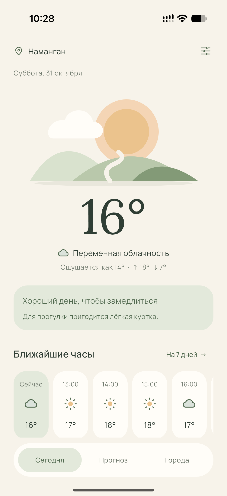
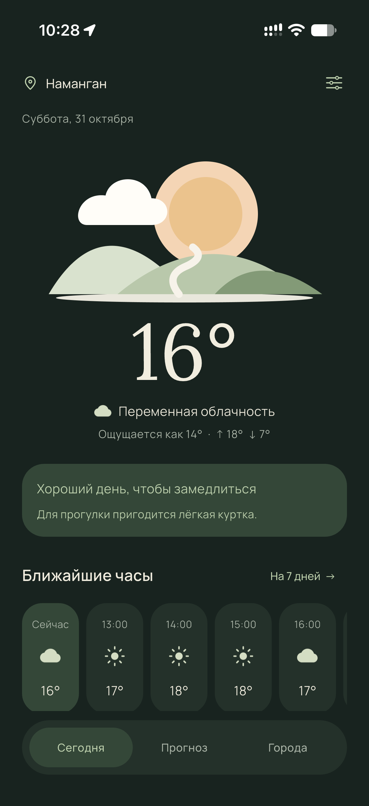
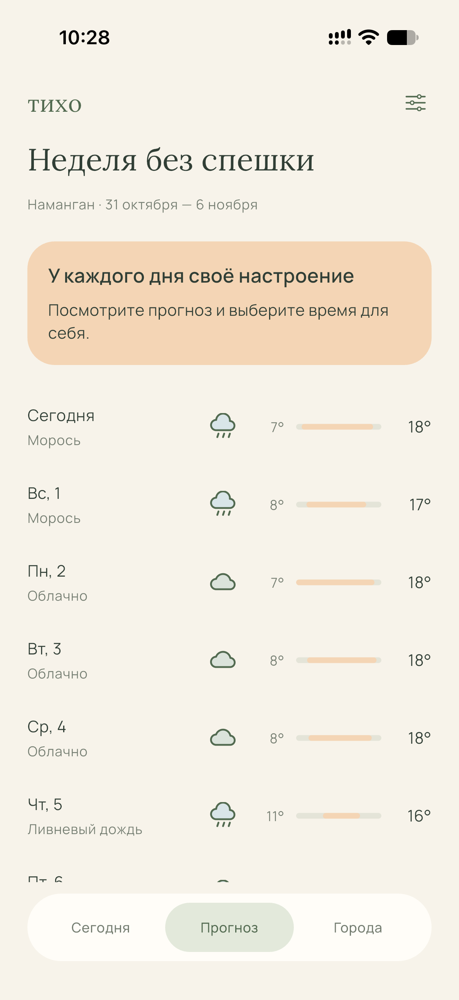
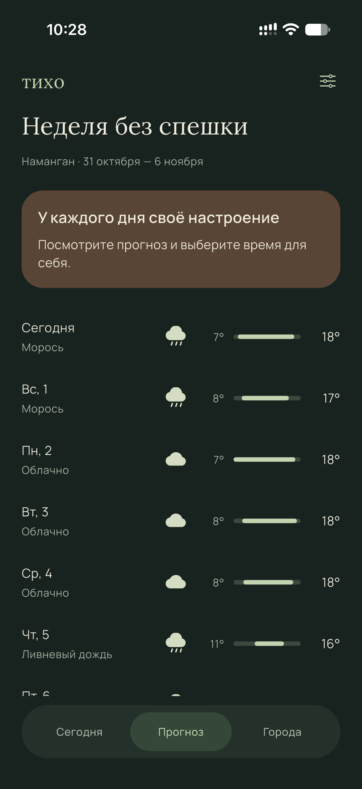
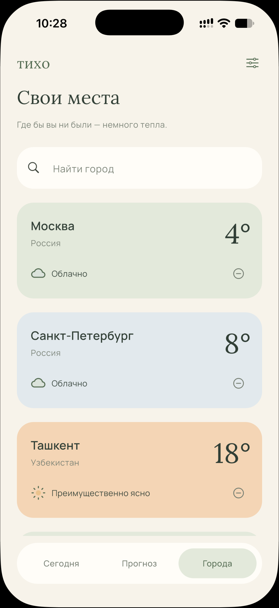
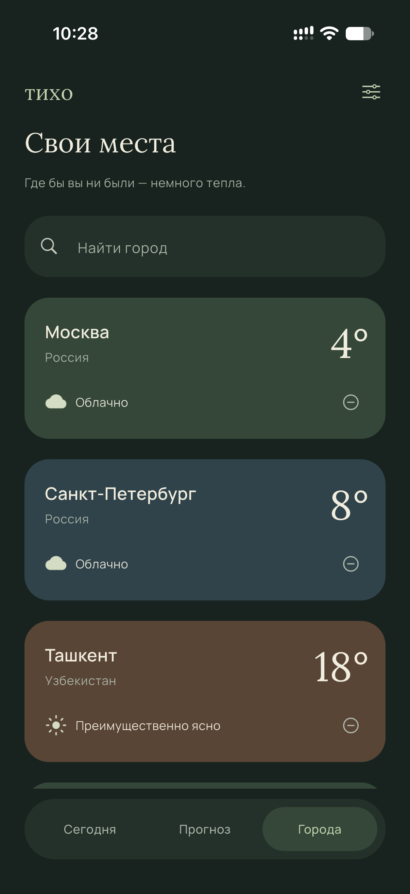
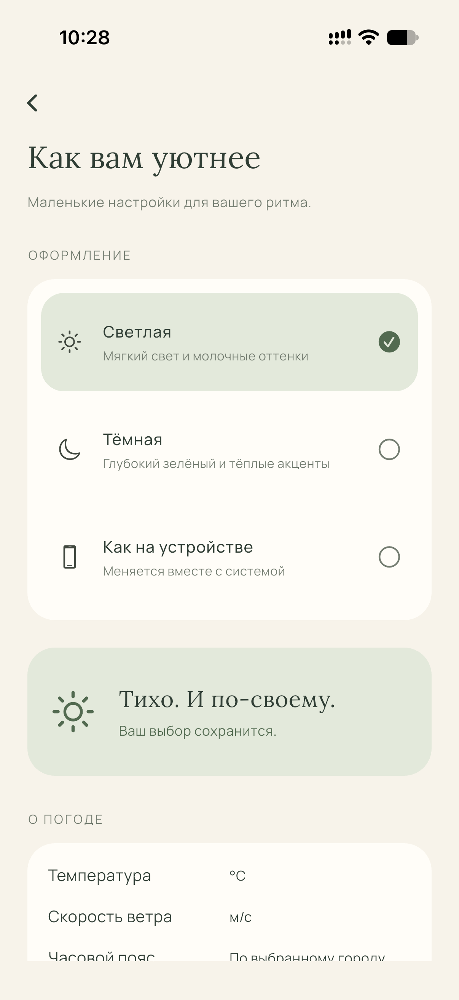
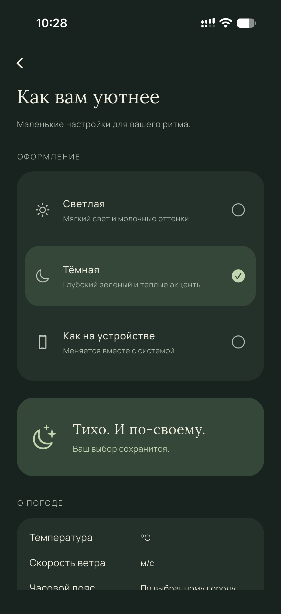

# Тихо — погода в своём ритме

Flutter-приложение для iOS по [макету Figma](https://www.figma.com/design/2dcNh4HJVt8UWRhyNwD27t?node-id=2-17).

## Скриншоты с iPhone

| Экран | Светлая тема | Тёмная тема |
| --- | --- | --- |
| Сегодня |  |  |
| Прогноз |  |  |
| Города |  |  |
| Настройки |  |  |

## Что работает

- Текущая погода, ощущаемая температура, ветер, влажность, осадки и закат.
- Прогноз на ближайшие 24 часа и 7 дней; подробности по нажатию на день.
- Поиск городов по всему миру, добавление, выбор и удаление.
- Светлая, тёмная и системная темы: кнопка настроек в верхнем правом углу.
- Сохранение городов, выбранной темы и последнего прогноза на устройстве.
- Обновление раз в 15 минут, при возвращении в приложение и жестом вниз.
- Отдельные состояния загрузки, ошибок и сохранённого прогноза без подмены данными примера.
- Русский интерфейс, прокрутка и поддержка узких экранов и увеличенного текста.

## Запуск на iPhone

1. Откройте Xcode и завершите первоначальную установку компонентов.
2. Подключите и разблокируйте iPhone, подтвердите «Доверять этому компьютеру».
3. Дважды нажмите **Подготовить iPhone.command** в этой папке. Скрипт скачает iOS-артефакты Flutter, получит зависимости и откроет `ios/Runner.xcworkspace`.
4. В Xcode: Settings → Apple Accounts → добавьте свой Apple ID, если его ещё нет.
5. В проекте: Runner → TARGETS / Runner → Signing & Capabilities → Automatically manage signing → выберите свой Team (Personal Team подходит для своего телефона).
6. Выберите iPhone в верхней панели Xcode и нажмите ▶ Run. Схема Runner запускает Release без отладчика: приложение можно открывать с иконки.
7. Если запрошено: iPhone → Настройки → Конфиденциальность и безопасность → Режим разработчика; перезагрузите и подтвердите. Для личной подписи также может понадобиться доверие разработчику в Настройки → Основные → VPN и управление устройством.

Настройка по [официальной инструкции Flutter](https://docs.flutter.dev/platform-integration/ios/setup).

Альтернатива из Терминала:

```sh
cd "$HOME/Desktop/Flutter iOS"
export DEVELOPER_DIR=/Applications/Xcode.app/Contents/Developer
flutter precache --ios
flutter pub get
flutter run --release -d <идентификатор-iPhone>
```

Для повторного запуска сначала настройте подпись в Xcode. Для обычного запуска с экрана телефона удобен release-режим. Автоматическую подпись и Apple ID нужно настроить на своём Mac; секреты в проект не добавлены.

## API

[Open-Meteo](https://open-meteo.com/) — HTTPS, ключ не нужен. Используются `/v1/forecast` и [Geocoding API](https://open-meteo.com/en/docs/geocoding-api). Температура в °C, ветер в м/с, даты прогноза в часовом поясе выбранного города (`timezone=auto`). Обозначения WMO преобразуются в русские описания и погодные иконки.

[Бесплатный публичный тариф](https://open-meteo.com/en/pricing) предназначен для некоммерческого использования, до 10 000 запросов в день. Для коммерческого выпуска проверьте условия сервиса. Данные — [CC BY 4.0](https://creativecommons.org/licenses/by/4.0/); атрибуция и ссылки есть внутри приложения. Геокодирование использует GeoNames.

Геолокация GPS не запрашивается. На серверы Open-Meteo передаются координаты выбранного города или введённый поисковый запрос. Нет рекламы, аналитики и собственного сервера. Настройки и кэш хранятся локально через iOS UserDefaults; для них добавлен PrivacyInfo.xcprivacy.

## Версии и структура

Проверено доступным Flutter **3.47.1 stable / Dart 3.13.1**, Xcode **27.2** обнаружен. Версии прямых пакетов закреплены в pubspec.yaml, разрешённые версии — в pubspec.lock, SDK — в .fvmrc. Обновление SDK из этой среды невозможно из-за сетевых ограничений.

- `lib/data/` — модели, Open-Meteo, кэш и состояние.
- `lib/ui/` — экраны, общие компоненты и две палитры.
- `assets/` — локальные Manrope/Lora с OFL-лицензиями и точные экспортированные изображения Figma.
- `ios/Runner/` — iOS-проект, канал сохранения и Privacy Manifest.
- `test/` — тесты API-контракта, часовых поясов, кэша, гонок запросов, навигации, темы и размеров экрана.
- `artifacts/previews/` — реальные рендеры Flutter на тестовых погодных данных, не скриншоты живого прогноза.
- `web/` — дополнительная браузерная цель; для неё нужен `flutter precache --web`.

## Проверки

```sh
flutter analyze
flutter test
```

В рабочей среде стандартный test runner не может открыть localhost-сокет. Те же тесты выполнены напрямую через flutter_tester с `tool/run_headless_tests.dart`: **10 тестов прошли** (плюс setUpAll и tearDownAll). Визуально проверены три экрана, настройки и тёмная тема, 320×568 с масштабом текста 1.3. Анализатор не сообщает ошибок.

Release-сборка установлена на iPhone. Работа приложения подтверждена владельцем на устройстве; скриншоты выше показывают живой прогноз, города и обе темы. API-контракт и ошибки также проверены через HTTP-моки. Скрипт подготовки предназначен для запуска в обычном Терминале Mac.

## Сообщение о debug mode на iPhone

Если установленная отладочная версия показывает «In iOS 14+, debug mode Flutter apps can only be launched…», пересоберите и установите Release. В общей схеме Runner Run уже настроен на Release, Debug executable отключён. В Xcode нажмите Product → Scheme → Edit Scheme → Run → Info и проверьте Build Configuration: Release, затем снова ▶ Run. Удалять приложение и сохранённые города не требуется. Для отладки по-прежнему доступна команда `flutter run` из Терминала.
